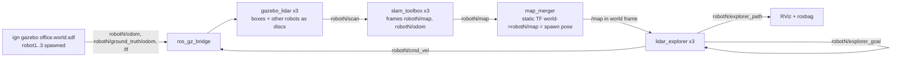

# Fleet Management — 3-Robot Collaborative Mapping Plan

## Objective

Three robots explore the Gazebo office **at the same time**, build **one shared map**, and every
robot's **trajectory is tracked** (SLAM estimate vs ground truth).

Reference implementation: `../AMR_Practice_project/src/amr_bot` (single robot, same office, same
explorer algorithm). Process log: [PROCESS.md](PROCESS.md).

## Architecture

Naming convention: everything per robot lives under namespace `robotN` (topics) and frame prefix
`robotN/` (TF). The only shared things are `/clock`, `/tf`, `/tf_static`, `/map` and the `world` frame.

## Key design decisions

| Decision | Why |
|---|---|
| One `slam_toolbox` per robot + map merge | slam_toolbox (Humble) is single-robot |
| Merge with **known spawn poses** (static TF `world -> robotN/map`) | Spawn poses are ours to choose; no feature matching needed. Upgrade to `multirobot_map_merge` only if walls double |
| Explorers plan on the **merged** map | A robot never re-explores what another already mapped |
| Coordination = goal reservation | Each robot publishes its frontier; others skip frontiers within ~2 m of it. No central task allocator |
| `gazebo_lidar` (ray cast) instead of Gazebo `gpu_lidar` | `gpu_lidar` crashes the gz server on this machine (AMR PROCESS.md §30–34) |
| Lidar also sees other robots as discs | Static-box ray cast is blind to robots otherwise -> collisions |
| Trajectories via `ros2 bag` + a plot script | No custom logger node needed |

## Files copied from AMR (done, see PROCESS.md §1)

| File | Status / change still needed |
|---|---|
| `src/lidar_explorer.cpp` | Phase 6: relative topics, frame params, goal reservation |
| `src/gazebo_lidar.cpp` | Phase 4: relative topics, `robotN/lidar_link`, other robots as discs |
| `urdf/supermarketbot.urdf`, `models/meshes/` | `package://` already renamed to `fleet_manager` |
| `scripts/urdf_gazebo_nosensors.py` | Phase 2: `--ns robotN` arg rewriting plugin topics/frames |
| `models/gazebo/office.world.sdf`, `models/gazebo/office/` | as is |
| `config/async_slam_toolbox_cfg.yaml` | per-robot frames/topics overridden from launch |
| `launch/gazebo.launch.py` | replaced by `fleet.launch.py` (deleted) |
| `maps/office.{pgm,yaml}` | reference only: pick free spawn poses |

Not copied: `mujoco_bridge`, `gazebo_camera` (MuJoCo), `path_logger` (nav2-specific),
`obstacle_avoider`, nav2 params, MuJoCo models.

## Phases

Each phase ends with a check that must pass before moving on.

- [x] **1. Package skeleton** — `CMakeLists.txt`, `package.xml`, assets copied.
  *Check:* `colcon build` passes in the container.
- [x] **2. One namespaced robot** — `urdf_gazebo_nosensors.py --ns robot1` rewrites diff-drive /
  odometry-publisher / joint-state topics to `robot1/...` and frames to `robot1/odom`,
  `robot1/base_link`; RSP with `frame_prefix: robot1/`.
  *Check:* teleop on `robot1/cmd_vel` drives it; TF tree `robot1/odom -> robot1/base_link -> ...`.
- [x] **3. Three robots** — `fleet.launch.py` loops over spawn poses (x, y, yaw) in different rooms:
  spawn + bridge + RSP + lidar + SLAM per robot.
  *Check:* three `robotN/map` topics in RViz.
- [x] **4. Robots see each other** — each `gazebo_lidar` subscribes to the other robots'
  `ground_truth/odom` and ray casts a disc (r ≈ 0.15 m) per robot.
  *Check:* two robots face to face appear in each other's scan.
- [x] **5. `map_merger` node** — static TF `world -> robotN/map` = spawn pose; overlays the 3 grids
  into `/map` (occupied if any says occupied, else free if any says free, else unknown).
  *Check:* merged map aligned, no doubled walls.
- [ ] **6. Multi-robot explorer** — relative topics, `map_frame=world`, `base_frame=robotN/base_link`,
  plans on merged `/map`, publishes `robotN/explorer_goal`, skips frontiers near other robots' goals.
  *Check:* all 3 move simultaneously to different frontiers; exploration completes.
- [ ] **7. Trajectory tracking** — `explorer_path` in `world` frame (3 colours in RViz);
  `ros2 bag record` ground truth + paths; `scripts/plot_trajectories.py` -> merged map + per-robot
  estimated vs true path + drift.
  *Check:* PNG with 3 coloured trajectories over the final map.
- [ ] **8. Wrap-up** — `map_saver_cli` merged map, README rewritten for this project.
- [x] **9. Navigation: closest robot takes the goal** — save the merged map; `fleet.launch.py map:=...`
  runs map_server (frame `world`) + per robot AMCL (initial pose = spawn) + nav2 (planner, controller,
  behaviors, bt_navigator). `goal_dispatcher`: `/goal_pose` -> `compute_path_to_pose` on every robot ->
  shortest path (idle first) gets `navigate_to_pose`.
  *Check:* goal (2,5): robot1 5.4 m / robot2 11.7 m / robot3 20.5 m -> robot1 drove there, others idle.

## Risks

- 3× SLAM + Gazebo on the iGPU may run below real time — fine with `use_sim_time`; raise
  `throttle_scans` if SLAM lags.
- Robots deadlocking in doorways — existing stuck/escape logic first; add "lower id yields" if needed.
- Fixed `world -> robotN/map` relies on SLAM's map origin = spawn pose: spawn at the exact pose/yaw.
