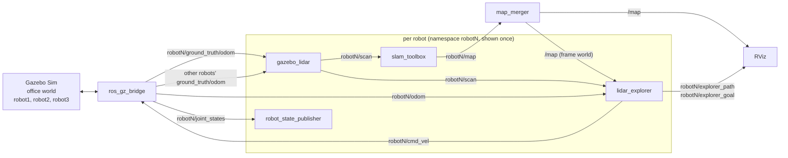
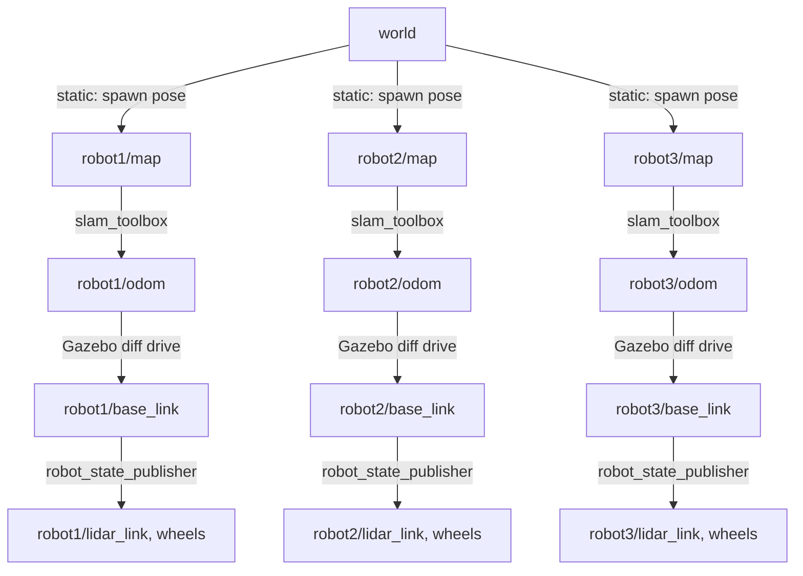

# Fleet Management

Three robots explore an office in Gazebo at the same time, build one shared map, and track their trajectories.

ROS 2 Humble, C++, Gazebo Sim (Fortress). The exploration algorithm comes from (https://github.com/Spathneja21/AMR).

## Commands

Everything runs inside Docker, in the `supermarketbot:humble` image (ROS 2 Humble, slam_toolbox, Gazebo Fortress).

### One-time container setup
```bash
xhost +local:docker          # repeat after every host login
docker run -it --name fleet \
  --net=host \
  -e DISPLAY=$DISPLAY \
  -v /tmp/.X11-unix:/tmp/.X11-unix \
  -v ~/projects/fleet_management:/ros2_ws \
  --device /dev/dri/card0 --device /dev/dri/renderD128 \
  --entrypoint bash \
  supermarketbot:humble
```

### Every session
```bash
docker start -ai fleet       # or a second shell: docker exec -it fleet bash
cd /ros2_ws
source /opt/ros/humble/setup.bash
colcon build --symlink-install && source install/setup.bash
```

### Run: three robots
Run each command in its own terminal, inside the container. Don't set `LIBGL_ALWAYS_SOFTWARE`.
```bash
# 1. world (-r starts it running)
export GZ_SIM_RESOURCE_PATH=/ros2_ws/src/fleet_manager/models/gazebo:/ros2_ws/src
ign gazebo -r /ros2_ws/src/fleet_manager/models/gazebo/office.world.sdf
# 2. three robots: spawn, bridge, TF, lidar, SLAM and explorer for each
ros2 launch fleet_manager fleet.launch.py          # explore:=false -> robots + SLAM only
# 3. visualisation
rviz2 --ros-args -p use_sim_time:=true
```
In RViz, set Fixed Frame to `world`. Add a Map display on `/map` with Durability Policy set to Transient Local,
and a Path display on each `/robotN/explorer_path`.

Each robot lives in its own namespace (`robot1`..`robot3`) with TF prefix `robotN/`. Spawn poses are
set in `ROBOTS` at the top of `launch/fleet.launch.py`.

Drive one robot by hand (with `explore:=false`):
```bash
ros2 run teleop_twist_keyboard teleop_twist_keyboard --ros-args -r cmd_vel:=/robot1/cmd_vel
```

## Architecture

### Nodes and topics

Each robot runs the same stack inside its own namespace. The only shared pieces are Gazebo, the bridge,
`/tf` and the merged `/map`.



| Node | Count | Role |
|---|---|---|
| `ros_gz_bridge` | 1 | Gazebo <-> ROS 2: `/clock`, `/tf`, and each robot's `cmd_vel`, `odom`, `ground_truth/odom`, `joint_states` |
| `robot_state_publisher` | 3 | URDF link frames, prefixed `robotN/` |
| `gazebo_lidar` | 3 | 360-beam scan by ray casting from the true pose against the office walls **and the other robots** (Gazebo's own lidar crashes on this machine) |
| `slam_toolbox` | 3 | Builds that robot's own map `robotN/map` and corrects its odometry drift |
| `map_merger` | 1 | Fuses the three robot maps into one `/map` in the `world` frame |
| `lidar_explorer` | 3 | Picks the nearest reachable frontier on the shared `/map` and drives there, steering through lidar gaps |
| `static_transform_publisher` | 3 | Places each robot's map in the world (`world -> robotN/map`) |

### TF tree



Each SLAM instance starts its map at the robot's start pose, so `world -> robotN/map` is just the spawn
pose (`ROBOTS` in `launch/fleet.launch.py`). Every robot can therefore be located in `world`, which is
the frame the explorers plan in.

### Map merging

Once a second, `map_merger` takes the latest map from each robot and places it in `world` using TF. For
every cell of the output grid it looks up the matching cell in each robot map:

| Robot maps say | Merged cell |
|---|---|
| any robot: occupied | occupied |
| otherwise, any robot: free | free |
| all robots: unknown | unknown |

Because every explorer plans on this merged map, a robot treats space another robot has already mapped
as explored and heads for a different frontier.

Limitation: merging trusts the spawn poses exactly. If walls ever appear doubled, the map placement has
to be estimated from the scans instead.
