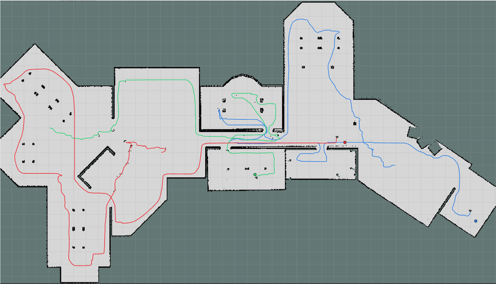
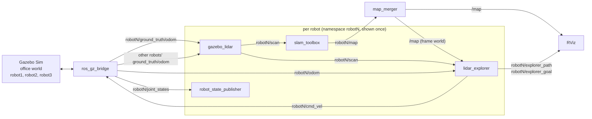
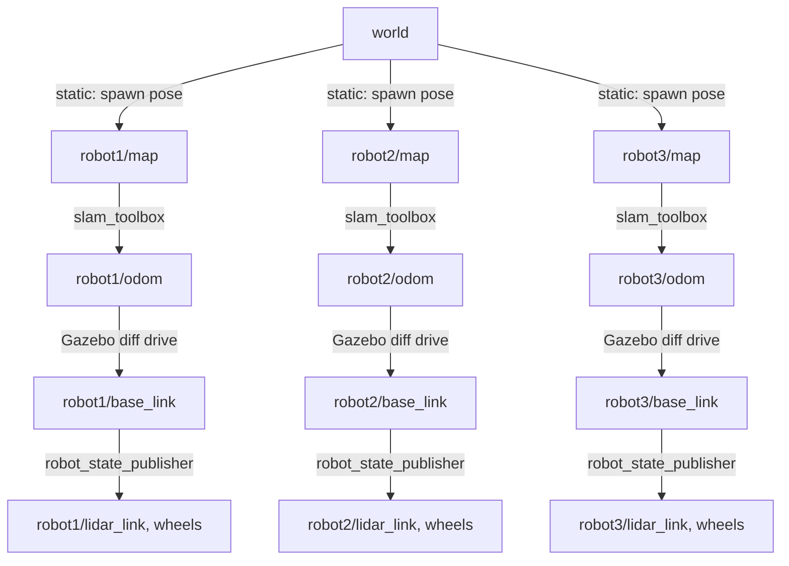
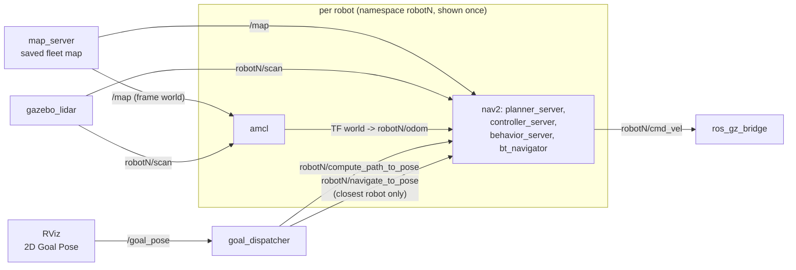
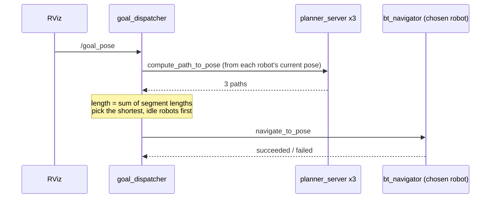

# Fleet Management

Three robots explore an office in Gazebo at the same time, build one shared map, and track their trajectories.

ROS 2 Humble, C++, Gazebo Sim (Fortress). The exploration algorithm comes from (https://github.com/Spathneja21/AMR).



The merged `/map` after a full run, with each robot's path: robot1 red (centre), robot2 green (left wing),
robot3 blue (right wing). Dots mark where each robot ended. Because they plan on the shared map,
each robot explores its own part of the office instead of covering ground another robot already mapped.

## Commands

Everything runs inside Docker, in the `supermarketbot:humble` image (ROS 2 Humble, slam_toolbox, Gazebo Fortress).

### One-time container setup
```bash
xhost +local:docker          # repeat after every host login
docker run -it --name fleet \
  --net=host \
  -e DISPLAY=$DISPLAY \
  -v /tmp/.X11-unix:/tmp/.X11-unix \
  -v ~/projects/fleet_management:/ros2_ws \
  --device /dev/dri/card0 --device /dev/dri/renderD128 \
  --entrypoint bash \
  supermarketbot:humble
```

### Every session
```bash
docker start -ai fleet       # or a second shell: docker exec -it fleet bash
cd /ros2_ws
source /opt/ros/humble/setup.bash
colcon build --symlink-install && source install/setup.bash
```

### Run: three robots, mapping
Run each command in its own terminal, inside the container. Don't set `LIBGL_ALWAYS_SOFTWARE`.
```bash
# 1. world (-r starts it running)
export GZ_SIM_RESOURCE_PATH=/ros2_ws/src/fleet_manager/models/gazebo:/ros2_ws/src
ign gazebo -r /ros2_ws/src/fleet_manager/models/gazebo/office.world.sdf
# 2. three robots (spawn, bridge, TF, lidar, SLAM, explorer each) + map merger + RViz
ros2 launch fleet_manager fleet.launch.py          # explore:=false: no explorers, rviz:=false: no RViz
```
RViz opens with `config/fleet.rviz`, already set up with the merged `/map`, all three robot models, and each
robot's explorer path and current goal. Colours: robot1 red, robot2 green, robot3 blue.

Each robot lives in its own namespace (`robot1`..`robot3`) with TF prefix `robotN/`. Spawn poses are
set in `ROBOTS` at the top of `launch/fleet.launch.py`.

Drive one robot by hand (with `explore:=false`):
```bash
ros2 run teleop_twist_keyboard teleop_twist_keyboard --ros-args -r cmd_vel:=/robot1/cmd_vel
```

When the map is complete, save the merged map:
```bash
ros2 run nav2_map_server map_saver_cli -t /map -f /ros2_ws/src/fleet_manager/maps/fleet_office \
  --ros-args -p use_sim_time:=true
```

### Trajectory tracking

Record each robot's true path (`ground_truth/odom`) and SLAM-estimated path (`explorer_path`) during a
mapping run, alongside the merged map:
```bash
ros2 bag record -o runs/run1 /map \
  /robot1/ground_truth/odom /robot2/ground_truth/odom /robot3/ground_truth/odom \
  /robot1/explorer_path /robot2/explorer_path /robot3/explorer_path --use-sim-time
```
Then, outside or inside the container (needs `rosbag2_py`, numpy, matplotlib):
```bash
python3 src/fleet_manager/scripts/plot_trajectories.py runs/run1 --out runs/run1_trajectories.png
```
This draws each robot's true path (dashed) and SLAM path (solid) over the final merged map, and prints
each robot's path length and drift (distance between the true and estimated position over time):
```
robot     true (m)  slam (m)  mean drift  max drift
robot1        13.3      14.9      0.04 m     0.16 m
robot2        14.4      16.3      0.04 m     0.19 m
robot3        13.8      15.9      0.03 m     0.11 m
```

### Run: three robots, navigation (nav2)
Restart Gazebo first, so the robots are back at their spawn poses; AMCL starts from those poses.
```bash
# 1. world
export GZ_SIM_RESOURCE_PATH=/ros2_ws/src/fleet_manager/models/gazebo:/ros2_ws/src
ign gazebo -r /ros2_ws/src/fleet_manager/models/gazebo/office.world.sdf
# 2. three robots + saved map + AMCL and nav2 per robot + goal dispatcher + RViz
ros2 launch fleet_manager fleet.launch.py map:=/ros2_ws/src/fleet_manager/maps/fleet_office.yaml
```
In RViz, click **2D Goal Pose** and place a goal. The robot with the shortest planned path to it takes the
goal; the dispatcher logs every robot's path length and which one it picked. From a terminal:
```bash
ros2 topic pub --once /goal_pose geometry_msgs/msg/PoseStamped \
  "{header: {frame_id: world}, pose: {position: {x: 2.0, y: 5.0}, orientation: {w: 1.0}}}"
```

## Architecture

`fleet.launch.py` has two modes. **Mapping** (default) explores and builds the shared map.
**Navigation** (`map:=<saved map>`) uses that map to send each goal to the closest robot. Gazebo, the
bridge and the lidars are the same in both.

## Mapping mode

### Nodes and topics

Each robot runs the same stack inside its own namespace. The only shared pieces are Gazebo, the bridge,
`/tf` and the merged `/map`.



| Node | Count | Role |
|---|---|---|
| `ros_gz_bridge` | 1 | Gazebo <-> ROS 2: `/clock`, `/tf`, and each robot's `cmd_vel`, `odom`, `ground_truth/odom`, `joint_states` |
| `robot_state_publisher` | 3 | URDF link frames, prefixed `robotN/` |
| `gazebo_lidar` | 3 | 360-beam scan by ray casting from the true pose against the office walls **and the other robots** (Gazebo's own lidar crashes on this machine) |
| `slam_toolbox` | 3 | Builds that robot's own map `robotN/map` and corrects its odometry drift |
| `map_merger` | 1 | Fuses the three robot maps into one `/map` in the `world` frame |
| `lidar_explorer` | 3 | Picks the nearest reachable frontier on the shared `/map` and drives there, steering through lidar gaps |
| `static_transform_publisher` | 3 | Places each robot's map in the world (`world -> robotN/map`) |

### TF tree



Each SLAM instance starts its map at the robot's start pose, so `world -> robotN/map` is just the spawn
pose (`ROBOTS` in `launch/fleet.launch.py`). Every robot can therefore be located in `world`, which is
the frame the explorers plan in.

### Map merging

Once a second, `map_merger` takes the latest map from each robot and places it in `world` using TF. For
every cell of the output grid it looks up the matching cell in each robot map:

| Robot maps say | Merged cell |
|---|---|
| any robot: occupied | occupied |
| otherwise, any robot: free | free |
| all robots: unknown | unknown |

Because every explorer plans on this merged map, a robot treats space another robot has already mapped
as explored and heads for a different frontier.

Limitation: merging trusts the spawn poses exactly. If walls ever appear doubled, the map placement has
to be estimated from the scans instead.

## Navigation mode

### Nodes and topics

SLAM, the explorers and `map_merger` are replaced by a saved map, per-robot localization and nav2.



| Node | Count | Role |
|---|---|---|
| `map_server` | 1 | Publishes the saved merged map as `/map` in the `world` frame |
| `amcl` | 3 | Localizes the robot on the shared map; starts at the spawn pose; publishes `world -> robotN/odom` |
| nav2 servers | 3 sets | Planner (NavFn), controller (rotation shim + DWB), recovery behaviors, behavior tree navigator |
| `lifecycle_manager` | 3 + 1 | Brings each robot's nav2 nodes, and the map server, up in order |
| `goal_dispatcher` | 1 | Picks the closest robot for each goal and sends it there |

Each robot's nav2 nodes are started directly from `fleet.launch.py`, rather than through nav2's own
`navigation_launch.py`. That file remaps `/tf` into the robot's namespace, but this fleet shares one `/tf`.
`config/nav2_params.yaml` is written once with a `<robot>` placeholder, and the launch file fills it in
for each robot.

In this mode the TF chain is `world -> robotN/odom` (AMCL), then `robotN/base_link` (Gazebo diff drive).

### Choosing the closest robot



"Closest" means the shortest **planned path**, not straight-line distance: in an office, a robot just
behind a wall can be near the goal in a straight line but far from it along the corridors. Idle robots are
preferred. If every robot that can reach the goal is busy, the closest one is re-tasked.
